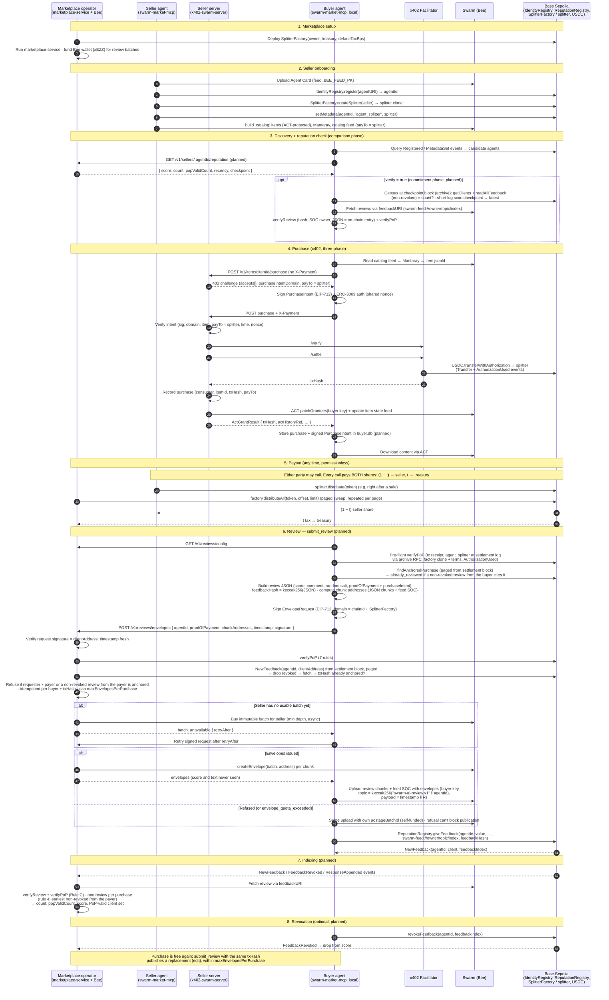

# Marketplace flow — end to end (incl. reputation)

Covers setup, seller onboarding, discovery, purchase, payout, review and indexing. Steps marked _(planned)_ are specified in `CLAUDE.md` but not built yet.

